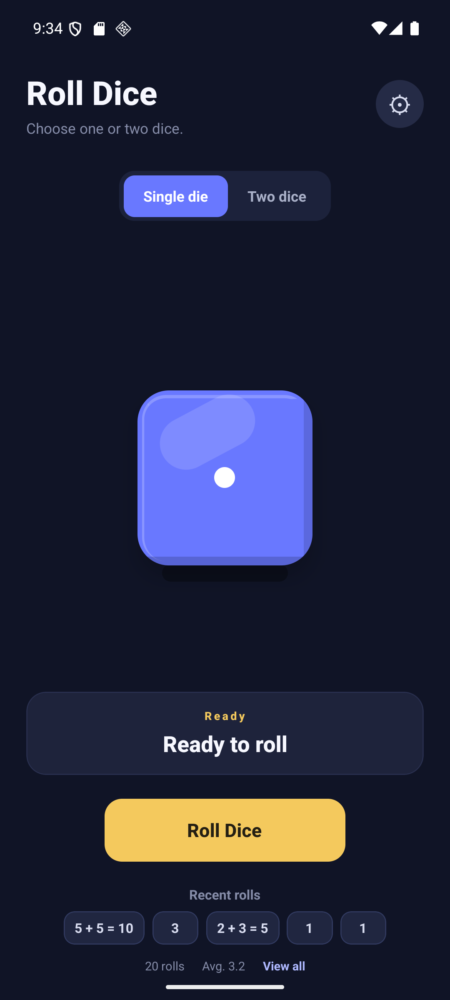
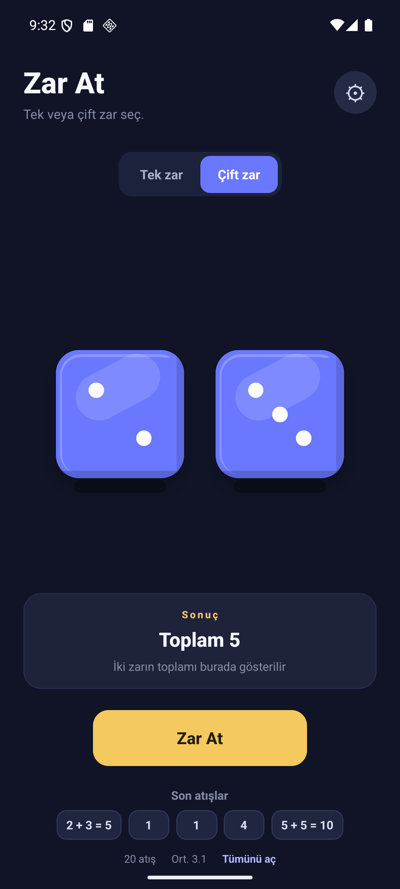

<p align="center">
  
</p>

<h1 align="center">Zar At</h1>

<p align="center">
  Reklamsız, kişiselleştirilebilir cep zarı.<br />
  An ad-free pocket dice roller for game nights, quick decisions, and everything in between.
</p>

<p align="center">Android · Türkçe / English · Expo + React Native</p>

<p align="center">
  
  &nbsp;&nbsp;
  
</p>

## Türkçe

Zar At; masa oyunları, hızlı kararlar ve günlük kullanım için tek ya da çift D6 zarını akıcı animasyon, ses ve haptik geri bildirimle atmanızı sağlar. Zarların renklerini ve malzemelerini kişiselleştirebilir, dokunarak veya telefonu sallayarak atış yapabilirsiniz.

- Tek veya çift zar ve kolay okunan toplam sonucu
- Her zar için ayrı görünüm sunan Zar Atölyesi
- Türkçe ve İngilizce arayüz
- Atış geçmişi, temel istatistikler, sallayarak atış ve azaltılmış hareket seçeneği
- Reklam, hesap veya uygulama bulut eşitlemesi yok

Ayarlar, görünüm ve atış geçmişi cihazınızda saklanır. Uygulama bahis veya gerçek para içermez.

## English

Zar At lets you roll one or two classic six-sided dice with smooth motion, sound, and haptic feedback. Customize the dice with your own colors and materials, then roll by tapping or shaking your phone.

- Single or two-dice mode with a clear total
- Dice Workshop with a separate look for each die
- Turkish and English interface
- Roll history, basic stats, shake-to-roll, and reduced motion
- No ads, account, or app cloud sync

Settings, appearance, and roll history stay on your device. The app contains no betting or real-money play.

## Teknoloji / Built with

React Native · Expo · TypeScript · Reanimated · Zustand

## Geliştirme / Development

```sh
npm install
npx expo start
```

## Bağlantılar / Links

- [Gizlilik politikası / Privacy policy](https://roll-dice-privacy.netlify.app/)
- [Play Store yayın rehberi / Play Store publishing guide](STORE_RELEASE_GUIDE.md)
